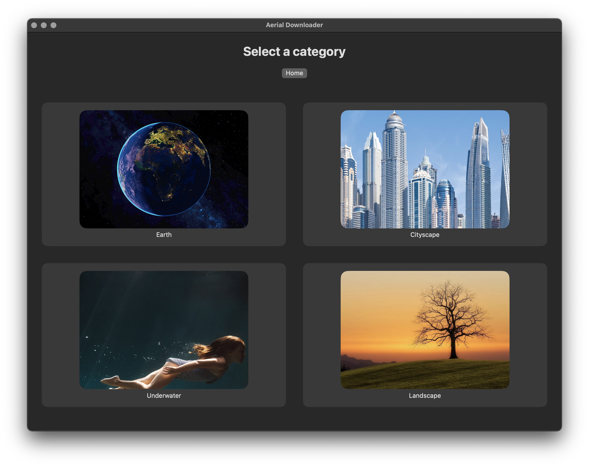
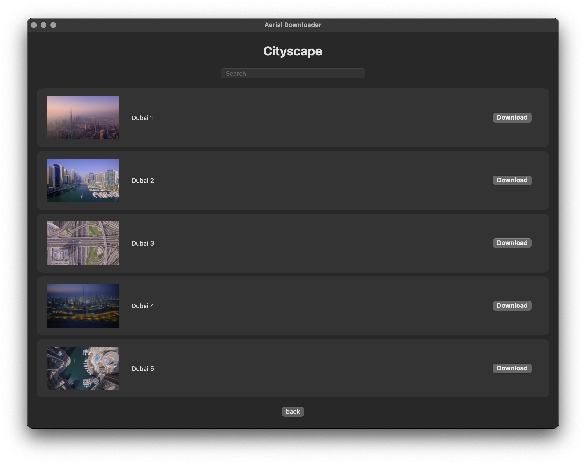

# Aerial Downloader
Download your favourite macOS Screensaver locally on your device. 





## Installation
### Download the Application
1. Visit the [Releases](../../releases/latest) page.
2. Download `AerialDownloader-v1.0.0-macOS.zip`.
3. Extract the ZIP file.
4. Drag `Aerial Downloader.app` into your Applications folder.
5. Launch the application.


## Building from Source
1. Clone this repository:
   ```bash
   git clone https://github.com/YOUR_USERNAME/AerialDownloader.git
   ```
2. Open `AerialDownloader.xcodeproj` in Xcode.
3. Build and run using `Command + R`.

## Category Images
The following category images are from the following sources:
1. Landscape: ```https://posterjack.ca/blogs/inspiration/15-great-landscape-photos-and-what-makes-them-great?srsltid=AU7gw4X1_ZlI-5wq-yhacMqX9ir1JMutDvjLCDn-UK9pmbkVYnouvZ6i```
2. Underwater: ```https://www.myclickmagazine.com/underwater-photography-with-elizabeth-blank/```
3. Cityscape: ```https://www.befunky.com/learn/city-skyline-photography/```
4. Earth: ```https://www.magnific.com/free-photo/3d-rendering-planet-earth_44957889.htm#fromView=keyword&page=1&position=1&uuid=976588c0-288d-4951-9f5a-61dae91562d4&track=ais_hybrid&query=Green+earth+4k+wallpaper```
